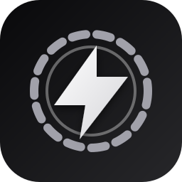
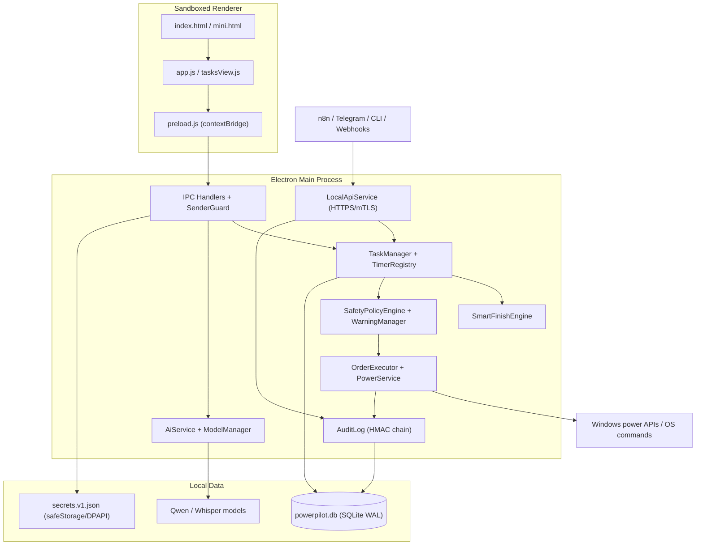
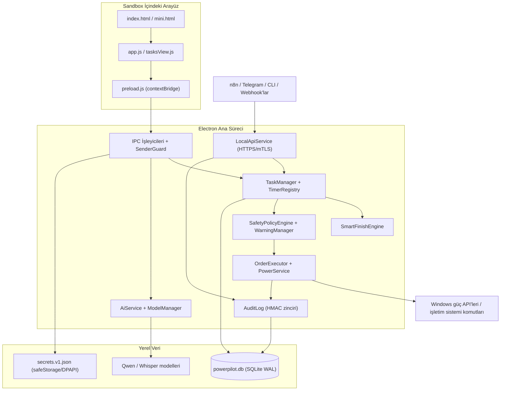

<div align="center">

# ⚡ Power Pilot — Windows Power Management & Automation

</div>

---

<div align="center">

[](#english-version)
&nbsp;&nbsp;&nbsp;&nbsp;
[](#turkish-version)

</div>

---

<div align="center">

[](https://github.com/emirtdede/Power-Pilot/actions/workflows/ci.yml)


</div>

---

<a id="english-version"></a>
# English Version

<div align="center">
  
  <h3>Power Pilot — Local-First Windows Power Automation</h3>
  <p><em>Scheduled power actions, Smart Finish conditions, on-device AI, and a hardened local API in one desktop app.</em></p>
  <p><strong>Developed &amp; Published by <a href="https://vellium.dev">Vellium</a></strong></p>
</div>

<br>

## 💻 Project Overview

**Power Pilot** is a local-first Windows desktop application for scheduling, monitoring, and automating power transitions. Built with **Electron 43**, **Node.js 24**, and **vanilla JavaScript**, it combines a hardened main process, a sandboxed renderer, and a local SQLite database. Core scheduling works without an account, a cloud service, or an internet connection.

It goes beyond a simple countdown. **Smart Finish** waits for real work to finish — a process to close, CPU usage to drop, the user to become idle, or a file/folder to stop changing. The **Safety Policy Engine** blocks risky actions while protected applications are running, and the optional **on-device AI assistant** turns natural-language or voice commands into automation tasks using locally stored Qwen and Whisper models.

For teams and advanced users, Power Pilot provides an optional **local REST API** with API-key roles, TLS/mTLS, IP allowlists, Ed25519-signed orders, webhooks, Wake-on-LAN, an n8n/Telegram workflow, a command-line client, and a headless Windows service agent. Every remote path is designed to fail closed.

> **Documentation:** architecture, audits, release process, runbooks, and API references are indexed in [`docs/README.md`](docs/README.md).

---

## 🚀 Key Features

### ⚡ Power Actions & Scheduling
- **Shutdown**, **Restart**, **Sleep**, **Hibernate**, **Lock**, and **Sign out** actions.
- Quick presets (15 min, 30 min, 1 hour, 2 hours) and custom countdowns.
- Safety-capped scheduling up to **24 days** (2,073,600 seconds).
- Persistent tasks with a pre-action warning countdown, snooze, cancel, and optional **PIN protection**.
- Automatic UI-language detection from the Windows display locale on first launch.

### 🧠 Smart Finish Condition Engine
- Wait for a selected **process** to close.
- Wait for **CPU usage** to remain below a configured threshold.
- Wait for keyboard/mouse **idle time**.
- Wait for a **file or folder** to stop growing/changing.
- Configurable **stability duration** (default 15–60 seconds) to prevent false triggers.

### 🛡️ Safety & Task Lifecycle
- **Protected-app rules** for games, IDEs, render tools, and video-call applications.
- Conflict resolution: one priority action at a time; conflicting tasks become `Blocked`.
- **Fail-closed remote shutdown protection** while the user is actively using the PC.
- Full task states: `Draft`, `Scheduled`, `Monitoring`, `Warning`, `Snoozed`, `Executing`, `Completed`, `Blocked`, `Failed`, `Expired`.

### 🤖 On-Device AI Assistant
- Optional **Qwen** local LLM for natural-language task creation.
- Optional **Whisper** speech-to-text for voice commands.
- Model files stay on the device; downloads are pinned to immutable URLs and verified by **SHA-256**.
- Inference runs locally — no cloud AI service is required.

### 📊 Dashboard, Templates & History
- Dashboard with the active task, next run, and quick actions.
- Reusable automation **templates**.
- Local **history** and estimated savings/usage statistics.
- Always-on-top **mini widget** and **system-tray** controls.
- Light and dark themes, desktop notifications, and Windows auto-start.

### 🔌 Integrations
- Local **REST API** (OpenAPI 3.0), bound to `127.0.0.1:18456` by default.
- API-key roles: `viewer`, `operator`, and `admin`, with rotation reminders.
- **n8n + Telegram** workflow included in [`integrations/n8n/`](integrations/n8n/).
- **PowerShell/CLI** client, outbound **webhooks** (none/HMAC/Basic auth), and **Wake-on-LAN** magic-packet wizard.
- Optional LAN mode with IP/CIDR allowlisting and TLS/mTLS.

### 🌎 Internationalization
- **17 languages**: Turkish, English, German, Swedish, Norwegian, Danish, French, Polish, Italian, Dutch, Czech, Spanish, Portuguese, Japanese, Chinese, Korean, and Arabic.
- Server-side tray, notification, and IPC messages are localized as well as the renderer UI.

### 🏢 Enterprise & Service Mode
- Optional **enterprise console** for LAN device orchestration.
- **Headless Windows service agent** for managed fleets.
- Policy templates, device inventory, signed orders, and receipt/audit reporting.

---

## 🛠️ Tech Stack

<div align="center">


</div>

### Runtime & UI
- **Electron 43.8.1** — Windows desktop runtime, tray, windows, and native integration
- **Node.js 24.18.1+** — main-process services, IPC, and tooling
- **HTML5 + CSS3 + vanilla JavaScript** — no frontend framework
- **Tailwind CSS 3.4.19** — build-time utility CSS, no runtime CDN
- **Material Symbols + Public Sans** — locally bundled icon and text fonts

### Data & Security
- **better-sqlite3 13** — WAL-mode SQLite with atomic migrations and `secure_delete`
- **@node-rs/argon2 2.2** — Argon2id PIN hashing with attempt lockout
- **Electron `safeStorage` / Windows DPAPI** — encrypted secrets at rest
- **Ed25519 + HMAC-SHA256** — signed orders and a tamper-evident audit chain
- **TLS/mTLS** — optional HTTPS local API with client certificates
- **Electron fuses + ASAR integrity** — hardened production packaging

### Automation, AI & Integrations
- **TaskManager + TimerRegistry** — persistent scheduling and execution claims
- **SmartFinishEngine + SafetyPolicyEngine** — condition evaluation and fail-closed policies
- **node-llama-cpp 3.20 + @fugood/whisper.node** — local Qwen/Whisper AI stack
- **Local REST API + OpenAPI 3.0** — n8n, CLI, webhook, and enterprise integrations
- **n8n / Telegram / Wake-on-LAN** — ready-made automation bridge

### Build, Test & Release
- **electron-builder 26.15** — NSIS installer and APPX packaging
- **Vitest 3.2 + Playwright 1.64** — unit, coverage, and Electron E2E tests
- **GitHub Actions** — CI, dependency audit, SBOM, signing, and release gates
- **CycloneDX SBOM + signature verification** — reproducible release evidence

---

## 📁 Project Structure

```text
Power_Pilot/
├── .github/                         # CI, Dependabot, issue/PR templates, security policy
├── build/appx/                      # Microsoft Store / APPX tile and splash assets
├── docs/                            # Architecture, audits, release, runbooks, API schema
│   ├── architecture/                # Automation, Smart Finish, safety, local API, enterprise
│   ├── audit/                       # QA and pre-deployment audit reports
│   ├── integrations/                # n8n and PowerShell/CLI guides
│   ├── openapi/                     # OpenAPI 3.0 schema for the local REST API
│   ├── release/                     # Signing, ASAR integrity, SBOM documentation
│   └── runbooks/                    # Incident response and operations
├── integrations/n8n/workflows/      # Ready-to-import n8n workflow (Telegram timer)
├── public/                          # Brand SVGs served by the app
├── scripts/                         # Release, packaging, security, backup, SBOM tools
├── src/
│   ├── agent/                       # Headless Windows service agent
│   ├── assets/                      # App and publisher logos
│   ├── cli/                         # Command-line client
│   ├── console/                     # Enterprise console server and store
│   ├── main/
│   │   ├── ai/                      # Input normalization and AI helpers
│   │   ├── config/                  # Feature flags and external-link policy
│   │   ├── ipc/                     # IPC validation and sender guard
│   │   ├── locales/                 # 17 server-side locale dictionaries
│   │   ├── order/                   # Signed order schema and nonce store
│   │   ├── security/                # App protocol, CSP paths, PIN, secrets, TLS, SSRF
│   │   ├── services/                # Task, power, AI, API, audit and history services
│   │   ├── storage/                 # SQLite storage and migrations
│   │   └── util/                    # Timers and shared helpers
│   ├── renderer/                    # Dashboard UI, mini widget and i18n client
│   ├── vendor/fonts/                # Locally bundled Material Symbols and Public Sans
│   ├── index.html                   # Main window markup
│   └── mini.html                    # Compact always-on-top mini widget
├── tests/                           # Vitest unit tests and Playwright Electron E2E tests
├── main.js                          # Electron main process, tray, windows, and IPC
├── preload.js                       # Context-isolated renderer bridge
├── electron-builder.config.cjs      # Signing-aware electron-builder configuration
├── tailwind.config.js               # Tailwind build configuration
├── playwright.config.js             # Electron E2E configuration
├── vitest.config.js                 # Unit and coverage configuration
├── package.json                     # Scripts, dependencies and build metadata
└── powerpilot_icon.ico              # Windows application icon
```

---

## 🔐 Architecture & Security Boundaries



**Security model.** The renderer never receives Node.js access. It runs with `sandbox: true` and `contextIsolation: true` behind the custom `app://powerpilot` protocol, a strict Content-Security-Policy, and an IPC sender allowlist. Every IPC payload is validated in the main process. Remote access is opt-in, bound to loopback by default, and protected by hashed API keys, role checks, rate limits, IP/CIDR allowlists, TLS/mTLS, and fail-closed remote-shutdown rules. Signed orders use Ed25519 with nonce replay protection, while the audit trail is chained with HMAC-SHA256 and daily checkpoints. Secrets are stored with Electron `safeStorage`/Windows DPAPI; PINs are hashed with Argon2id and protected by attempt lockout.

---

## 💾 Storage & Security Schema

| Path / Boundary | Protection | Contents |
| :--- | :--- | :--- |
| `%APPDATA%\powerpilot\powerpilot.db` | SQLite WAL, `secure_delete`, `quick_check` | Tasks, history, settings, and audit records |
| `%APPDATA%\powerpilot\secrets.v1.json` | Electron `safeStorage` / Windows DPAPI | API keys, TLS material, webhook secrets |
| `%APPDATA%\powerpilot\models\` | SHA-256 pinned downloads | Local Qwen LLM and Whisper STT models |
| `%APPDATA%\powerpilot\backups\` | App-managed backups | Database and log backups |
| `%APPDATA%\powerpilot\logs\` | Redacted diagnostics | Runtime and audit-support logs |
| Renderer ↔ main IPC | `contextIsolation`, `sandbox`, sender allowlist | Validated commands and events |

---

## ⚙️ Installation & Usage

### Prerequisites
- **Windows 10 (1809+) or Windows 11** (64-bit)
- **Node.js 24.18.1+** and npm
- **Git**
- **Visual Studio Build Tools** when native modules need to be rebuilt (`npm install` runs `electron-rebuild`)

### Run from Source

```bash
git clone https://github.com/emirtdede/Power-Pilot.git
cd Power-Pilot
npm install
npm start
```

### Tests & Release Gates

```bash
npm test                 # Vitest unit tests
npm run test:security    # Security checks
npm run test:e2e         # Playwright Electron E2E
npm run coverage         # Coverage report (release gate)
npm run locales:check    # 17-language key parity
npm run models:verify    # Model manifests and SHA-256
npm run release:check    # Release consistency gate
```

### Build Installers

```bash
# NSIS setup (dist/Power Pilot Setup 1.1.0.exe)
npm run dist:nsis

# APPX package (requires Windows SDK and APPX_PUBLISHER)
npm run dist:appx

# Unpacked application and packaging verification
npm run pack
npm run verify:pack
```

### Code Signing

Production builds are signed with the Windows certificate selected by subject name:

```powershell
$env:WIN_CERT_SUBJECT = "CN=Vellium, O=Vellium, C=TR"
# Optional when multiple certificates share the same subject
$env:WIN_CERT_SHA1 = "<certificate-thumbprint>"
# Optional local timestamp endpoint override
$env:WIN_TIMESTAMP_URL = "http://timestamp.digicert.com"

npm run dist:nsis
```

If `WIN_CERT_SUBJECT` is not set, packaging continues without signing; unsigned builds are intended for local testing only. See [`docs/release/RELEASE_SIGNING.md`](docs/release/RELEASE_SIGNING.md) and [`docs/release/ASAR-INTEGRITY.md`](docs/release/ASAR-INTEGRITY.md).

---

## 📦 Distribution Packages

Build artifacts are produced under `dist/`:

- **NSIS installer** — `Power Pilot Setup 1.1.0.exe`
- **APPX package** — `Power Pilot 1.1.0.appx`
- **Unpacked build** — `dist/win-unpacked/` via `npm run pack`
- **SBOM** — `npm run sbom`
- **Signature verification** — `npm run verify:signature`
- **Packaged E2E / verification** — `npm run verify:pack` and `scripts/packaged-e2e.ps1`

Published builds and release notes are available on the [GitHub Releases](https://github.com/emirtdede/Power-Pilot/releases) page.

---

## ⚖️ License

**Proprietary commercial software.** Copyright © 2026 Vellium. All rights reserved.

No rights are granted to copy, modify, publish, distribute, sublicense, or sell the software except under a separate written commercial or pilot agreement with Vellium. Pilot use is limited to the organization, duration, and device count stated in that agreement. See [`LICENSE`](LICENSE) for the full terms.

**Official Website:** [Vellium.dev](https://vellium.dev) • **Publisher:** Vellium • **Contact:** [info@vellium.dev](mailto:info@vellium.dev)

---

<br>

---

<a id="turkish-version"></a>
# Türkçe Versiyon

<div align="center">
  
  <h3>Power Pilot — Yerel Öncelikli Windows Güç Otomasyonu</h3>
  <p><em>Zamanlanmış güç eylemleri, Smart Finish koşulları, cihaz üzerinde yapay zekâ ve sıkılaştırılmış yerel API tek bir masaüstü uygulamasında.</em></p>
  <p><strong>Geliştirici ve Yayıncı: <a href="https://vellium.dev">Vellium</a></strong></p>
</div>

<br>

## 💻 Proje Genel Bakışı

**Power Pilot**, güç geçişlerini zamanlamak, izlemek ve otomatikleştirmek için geliştirilmiş, yerel öncelikli bir Windows masaüstü uygulamasıdır. **Electron 43**, **Node.js 24** ve **vanilla JavaScript** ile geliştirilmiştir; sıkılaştırılmış bir ana süreç, sandbox içindeki bir arayüz ve yerel bir SQLite veritabanını bir araya getirir. Temel zamanlama; hesap, bulut servisi veya internet bağlantısı gerektirmez.

Power Pilot basit bir geri sayımdan daha fazlasını yapar. **Smart Finish**, gerçek işin bittiğini algılar: seçilen sürecin kapanması, CPU kullanımının eşiğin altına düşmesi, kullanıcının boşta kalması veya bir dosya/klasörün değişmeyi bırakması. **Güvenlik Politikası Motoru**, korunan uygulamalar açıkken riskli eylemleri engeller; isteğe bağlı **cihaz üzeri yapay zekâ asistanı** ise doğal dil veya sesli komutları yerel Qwen ve Whisper modelleriyle otomasyon görevlerine dönüştürür.

Ekipler ve ileri düzey kullanıcılar için isteğe bağlı bir **yerel REST API** sunulur: API anahtarı rolleri, TLS/mTLS, IP izin listeleri, Ed25519 imzalı emirler, webhook'lar, Wake-on-LAN, n8n/Telegram iş akışı, komut satırı istemcisi ve başsız Windows servis ajanı. Tüm uzaktan erişim yolları fail-closed (güvenli tarafta kalacak şekilde) tasarlanmıştır.

> **Dokümantasyon:** mimari, denetimler, sürüm süreci, runbook'lar ve API referansları [`docs/README.md`](docs/README.md) içinde indekslenmiştir.

---

## 🚀 Öne Çıkan Özellikler

### ⚡ Güç Eylemleri ve Zamanlama
- **Kapatma**, **Yeniden Başlatma**, **Uyku**, **Hazırda Bekletme**, **Kilitleme** ve **Oturumu Kapatma** eylemleri.
- Hızlı ön ayarlar (15 dk, 30 dk, 1 saat, 2 saat) ve özel geri sayımlar.
- **24 güne** (2.073.600 saniye) kadar güvenlik sınırlı zamanlama.
- Eylem öncesi uyarı geri sayımı, erteleme, iptal ve isteğe bağlı **PIN koruması** ile kalıcı görevler.
- İlk açılışta Windows görüntüleme dilinden otomatik arayüz dili algılama.

### 🧠 Smart Finish Koşul Motoru
- Seçilen **sürecin** kapanmasını bekleme.
- **CPU kullanımının** belirlenen eşiğin altında kalmasını bekleme.
- Klavye/fare **boşta kalma süresini** bekleme.
- Bir **dosya veya klasörün** büyümeyi/değişmeyi bırakmasını bekleme.
- Yanlış tetiklemeleri önlemek için yapılandırılabilir **kararlılık süresi** (varsayılan 15–60 saniye).

### 🛡️ Güvenlik ve Görev Yaşam Döngüsü
- Oyunlar, IDE'ler, render araçları ve görüntülü görüşme uygulamaları için **korunan uygulama kuralları**.
- Çakışma çözümü: aynı anda tek öncelikli eylem; çakışan görevler `Blocked` durumuna geçer.
- Kullanıcı aktifken **fail-closed uzaktan kapatma koruması**.
- Tam görev durumları: `Draft`, `Scheduled`, `Monitoring`, `Warning`, `Snoozed`, `Executing`, `Completed`, `Blocked`, `Failed`, `Expired`.

### 🤖 Cihaz Üzerinde Yapay Zekâ Asistanı
- Doğal dilde görev oluşturma için isteğe bağlı yerel **Qwen** LLM.
- Sesli komutlar için isteğe bağlı yerel **Whisper** konuşma-metin motoru.
- Model dosyaları cihazda kalır; indirmeler değişmez URL'lere ve **SHA-256** doğrulamasına bağlıdır.
- Çıkarım yerel olarak çalışır — bulut yapay zekâ servisi gerekmez.

### 📊 Pano, Şablonlar ve Geçmiş
- Aktif görev, sonraki çalışma ve hızlı eylemleri gösteren pano.
- Yeniden kullanılabilir otomasyon **şablonları**.
- Yerel **geçmiş** ve tahmini tasarruf/kullanım istatistikleri.
- Her zaman üstte kalan **mini widget** ve **sistem tepsisi** kontrolleri.
- Açık/koyu tema, masaüstü bildirimleri ve Windows ile otomatik başlatma.

### 🔌 Entegrasyonlar
- Varsayılan olarak `127.0.0.1:18456` adresine bağlanan yerel **REST API** (OpenAPI 3.0).
- API anahtarı rolleri: `viewer`, `operator` ve `admin`; rotasyon hatırlatmaları.
- [`integrations/n8n/`](integrations/n8n/) altında hazır **n8n + Telegram** iş akışı.
- **PowerShell/CLI** istemcisi, giden **webhook'lar** (yok/HMAC/Basic auth) ve **Wake-on-LAN** sihirbazı.
- İsteğe bağlı LAN modu; IP/CIDR izin listesi ve TLS/mTLS desteği.

### 🌎 Çok Dilli Altyapı
- **17 dil**: Türkçe, İngilizce, Almanca, İsveççe, Norveççe, Danca, Fransızca, Lehçe, İtalyanca, Felemenkçe, Çekçe, İspanyolca, Portekizce, Japonca, Çince, Korece ve Arapça.
- Arayüzün yanı sıra tepsi, bildirimler ve IPC hata mesajları da yerelleştirilir.

### 🏢 Kurumsal ve Servis Modu
- LAN cihaz orkestrasyonu için isteğe bağlı **kurumsal konsol**.
- Yönetilen filolar için **başsız Windows servis ajanı**.
- Politika şablonları, cihaz envanteri, imzalı emirler ve makbuz/denetim raporlaması.

---

## 🛠️ Teknoloji Yığını

<div align="center">


</div>

### Çalışma Zamanı ve Arayüz
- **Electron 43.8.1** — Windows masaüstü çalışma zamanı, tepsi, pencereler ve yerel entegrasyon
- **Node.js 24.18.1+** — ana süreç servisleri, IPC ve araçlar
- **HTML5 + CSS3 + vanilla JavaScript** — önyüz çatısı yok
- **Tailwind CSS 3.4.19** — derleme zamanında üretilen yardımcı CSS; çalışma zamanında CDN yok
- **Material Symbols + Public Sans** — yerel olarak paketlenen ikon ve metin yazı tipleri

### Veri ve Güvenlik
- **better-sqlite3 13** — WAL modunda SQLite, atomik migrasyonlar ve `secure_delete`
- **@node-rs/argon2 2.2** — deneme kilitlemeli Argon2id PIN hash'leme
- **Electron `safeStorage` / Windows DPAPI** — diskte şifreli sırlar
- **Ed25519 + HMAC-SHA256** — imzalı emirler ve kurcalamaya dayanıklı denetim zinciri
- **TLS/mTLS** — istemci sertifikalı isteğe bağlı HTTPS yerel API
- **Electron fuses + ASAR bütünlüğü** — sıkılaştırılmış üretim paketleme

### Otomasyon, Yapay Zekâ ve Entegrasyonlar
- **TaskManager + TimerRegistry** — kalıcı zamanlama ve yürütme talepleri
- **SmartFinishEngine + SafetyPolicyEngine** — koşul değerlendirme ve fail-closed politikalar
- **node-llama-cpp 3.20 + @fugood/whisper.node** — yerel Qwen/Whisper yapay zekâ yığını
- **Yerel REST API + OpenAPI 3.0** — n8n, CLI, webhook ve kurumsal entegrasyonlar
- **n8n / Telegram / Wake-on-LAN** — hazır otomasyon köprüsü

### Derleme, Test ve Sürüm
- **electron-builder 26.15** — NSIS kurulum dosyası ve APPX paketleme
- **Vitest 3.2 + Playwright 1.64** — birim, kapsam ve Electron E2E testleri
- **GitHub Actions** — CI, bağımlılık denetimi, SBOM, imzalama ve sürüm kapıları
- **CycloneDX SBOM + imza doğrulama** — tekrarlanabilir sürüm kanıtı

---

## 📁 Proje Yapısı

```text
Power_Pilot/
├── .github/                         # CI, Dependabot, issue/PR şablonları, güvenlik politikası
├── build/appx/                      # Microsoft Store / APPX karo ve açılış görselleri
├── docs/                            # Mimari, denetim, sürüm, runbook ve API şeması
│   ├── architecture/                # Otomasyon, Smart Finish, güvenlik, yerel API, kurumsal
│   ├── audit/                       # QA ve yayın öncesi denetim raporları
│   ├── integrations/                # n8n ve PowerShell/CLI rehberleri
│   ├── openapi/                     # Yerel REST API için OpenAPI 3.0 şeması
│   ├── release/                     # İmzalama, ASAR bütünlüğü ve SBOM belgeleri
│   └── runbooks/                    # Olay müdahale ve operasyon prosedürleri
├── integrations/n8n/workflows/      # İçe aktarılabilir n8n iş akışı (Telegram zamanlayıcı)
├── public/                          # Uygulama tarafından sunulan marka SVG'leri
├── scripts/                         # Sürüm, paketleme, güvenlik, yedekleme ve SBOM araçları
├── src/
│   ├── agent/                       # Başsız Windows servis ajanı
│   ├── assets/                      # Uygulama ve yayıncı logoları
│   ├── cli/                         # Komut satırı istemcisi
│   ├── console/                     # Kurumsal konsol sunucusu ve deposu
│   ├── main/
│   │   ├── ai/                      # Girdi normalizasyonu ve yapay zekâ yardımcıları
│   │   ├── config/                  # Özellik bayrakları ve dış bağlantı politikası
│   │   ├── ipc/                     # IPC doğrulama ve gönderen koruması
│   │   ├── locales/                 # 17 sunucu tarafı yerelleştirme sözlüğü
│   │   ├── order/                   # İmzalı emir şeması ve nonce deposu
│   │   ├── security/                # Uygulama protokolü, CSP, PIN, sırlar, TLS, SSRF
│   │   ├── services/                # Görev, güç, yapay zekâ, API, denetim ve geçmiş servisleri
│   │   ├── storage/                 # SQLite depolama ve migrasyonlar
│   │   └── util/                    # Zamanlayıcılar ve ortak yardımcılar
│   ├── renderer/                    # Pano arayüzü, mini widget ve i18n istemcisi
│   ├── vendor/fonts/                # Yerel Material Symbols ve Public Sans
│   ├── index.html                   # Ana pencere işaretlemesi
│   └── mini.html                    # Kompakt, her zaman üstte mini widget
├── tests/                           # Vitest birim testleri ve Playwright Electron E2E testleri
├── main.js                          # Electron ana süreci, tepsi, pencereler ve IPC
├── preload.js                       # Context-isolated renderer köprüsü
├── electron-builder.config.cjs      # İmzalama farkındalıklı electron-builder yapılandırması
├── tailwind.config.js               # Tailwind derleme yapılandırması
├── playwright.config.js             # Electron E2E yapılandırması
├── vitest.config.js                 # Birim ve kapsam yapılandırması
├── package.json                     # Scriptler, bağımlılıklar ve derleme metaverisi
└── powerpilot_icon.ico              # Windows uygulama simgesi
```

---

## 🔐 Mimari ve Güvenlik Sınırları



**Güvenlik modeli.** Arayüz hiçbir zaman Node.js erişimine sahip olmaz. `sandbox: true` ve `contextIsolation: true` ile, özel `app://powerpilot` protokolü, sıkı Content-Security-Policy ve IPC gönderen allowlist'i arkasında çalışır. Her IPC yükü ana süreçte doğrulanır. Uzaktan erişim isteğe bağlıdır; varsayılan olarak loopback'e bağlanır ve hash'lenmiş API anahtarları, rol kontrolleri, hız sınırları, IP/CIDR izin listeleri, TLS/mTLS ve fail-closed uzaktan kapatma kurallarıyla korunur. İmzalı emirler Ed25519 ve nonce tekrar koruması kullanır; denetim izi HMAC-SHA256 ve günlük checkpoint'lerle zincirlenir. Sırlar Electron `safeStorage`/Windows DPAPI ile saklanır; PIN'ler Argon2id ile hash'lenir ve deneme kilidiyle korunur.

---

## 💾 Depolama ve Güvenlik Şeması

| Yol / Sınır | Koruma | İçerik |
| :--- | :--- | :--- |
| `%APPDATA%\powerpilot\powerpilot.db` | SQLite WAL, `secure_delete`, `quick_check` | Görevler, geçmiş, ayarlar ve denetim kayıtları |
| `%APPDATA%\powerpilot\secrets.v1.json` | Electron `safeStorage` / Windows DPAPI | API anahtarları, TLS materyali, webhook sırları |
| `%APPDATA%\powerpilot\models\` | SHA-256 sabitlenmiş indirmeler | Yerel Qwen LLM ve Whisper STT modelleri |
| `%APPDATA%\powerpilot\backups\` | Uygulama yönetimli yedekler | Veritabanı ve günlük yedekleri |
| `%APPDATA%\powerpilot\logs\` | Maskelenmiş tanılama | Çalışma zamanı ve denetim destek günlükleri |
| Arayüz ↔ ana süreç IPC | `contextIsolation`, `sandbox`, gönderen allowlist'i | Doğrulanmış komutlar ve olaylar |

---

## ⚙️ Kurulum ve Kullanım

### Gereksinimler
- **Windows 10 (1809+) veya Windows 11** (64-bit)
- **Node.js 24.18.1+** ve npm
- **Git**
- Yerel modüllerin yeniden derlenmesi gerektiğinde **Visual Studio Build Tools** (`npm install` sonrasında `electron-rebuild` çalışır)

### Kaynaktan Çalıştırma

```bash
git clone https://github.com/emirtdede/Power-Pilot.git
cd Power-Pilot
npm install
npm start
```

### Testler ve Sürüm Kapıları

```bash
npm test                 # Vitest birim testleri
npm run test:security    # Güvenlik kontrolleri
npm run test:e2e         # Playwright Electron E2E
npm run coverage         # Kapsam raporu (sürüm kapısı)
npm run locales:check    # 17 dil anahtar eşliği
npm run models:verify    # Model manifestleri ve SHA-256
npm run release:check    # Sürüm tutarlılık kapısı
```

### Kurulum Dosyalarını Derleme

```bash
# NSIS kurulum dosyası (dist/Power Pilot Setup 1.1.0.exe)
npm run dist:nsis

# APPX paketi (Windows SDK ve APPX_PUBLISHER gerektirir)
npm run dist:appx

# Paketlenmemiş uygulama ve paket doğrulama
npm run pack
npm run verify:pack
```

### Kod İmzalama

Üretim derlemeleri, konu adıyla seçilen Windows sertifikasıyla imzalanır:

```powershell
$env:WIN_CERT_SUBJECT = "CN=Vellium, O=Vellium, C=TR"
# Aynı konu adını paylaşan birden fazla sertifika varsa isteğe bağlı
$env:WIN_CERT_SHA1 = "<sertifika-parmak-izi>"
# Yerel zaman damgası uç noktası geçersiz kılma (isteğe bağlı)
$env:WIN_TIMESTAMP_URL = "http://timestamp.digicert.com"

npm run dist:nsis
```

`WIN_CERT_SUBJECT` tanımlı değilse paketleme imzasız devam eder; imzasız derlemeler yalnızca yerel test içindir. Ayrıntılar: [`docs/release/RELEASE_SIGNING.md`](docs/release/RELEASE_SIGNING.md) ve [`docs/release/ASAR-INTEGRITY.md`](docs/release/ASAR-INTEGRITY.md).

---

## 📦 Dağıtım Paketleri

Derleme çıktıları `dist/` altında üretilir:

- **NSIS kurulum dosyası** — `Power Pilot Setup 1.1.0.exe`
- **APPX paketi** — `Power Pilot 1.1.0.appx`
- **Paketlenmemiş derleme** — `npm run pack` ile `dist/win-unpacked/`
- **SBOM** — `npm run sbom`
- **İmza doğrulama** — `npm run verify:signature`
- **Paketli E2E / doğrulama** — `npm run verify:pack` ve `scripts/packaged-e2e.ps1`

Yayınlanan derlemeler ve sürüm notları [GitHub Releases](https://github.com/emirtdede/Power-Pilot/releases) sayfasında bulunur.

---

## ⚖️ Lisans

**Tescilli ticari yazılım.** Copyright © 2026 Vellium. Tüm hakları saklıdır.

Yazılımı kopyalama, değiştirme, yayınlama, dağıtma, alt lisanslama veya satma hakları; Vellium ile ayrı bir yazılı ticari veya pilot anlaşması olmadıkça verilmez. Pilot kullanımı, anlaşmada belirtilen kuruluş, süre ve cihaz sayısıyla sınırlıdır. Tam koşullar için [`LICENSE`](LICENSE) dosyasına bakın.

**Resmi Web Sitesi:** [Vellium.dev](https://vellium.dev) • **Yayıncı:** Vellium • **İletişim:** [info@vellium.dev](mailto:info@vellium.dev)
